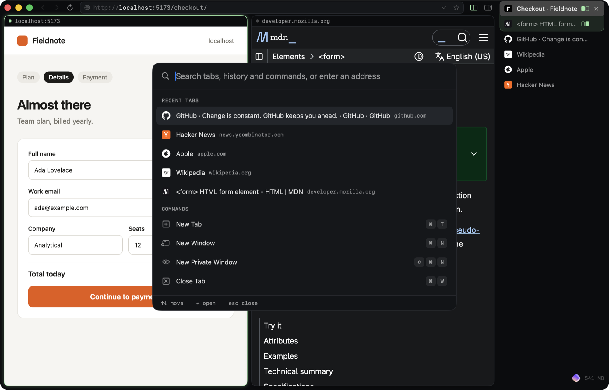
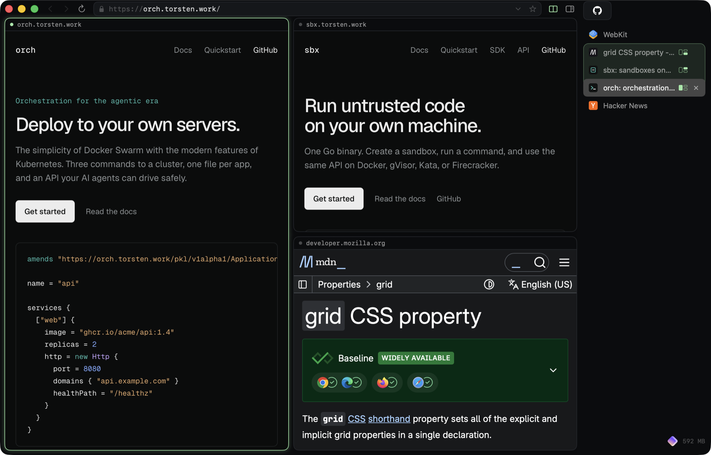

# Tern

A fast, keyboard-first browser for macOS, built on WebKit with Swift and AppKit.
Vertical tabs, split view, a command palette, rebindable shortcuts, and support for Safari Web Extensions.



> **Status:** early and moving fast. Tern works as a daily browser, but there are no prebuilt releases yet. Build it from source (it takes about a minute).

## Highlights

- **Native and lightweight.** Plain AppKit around `WKWebView`: no Electron and no bundled Chromium. The release build is under 1 MB.
- **Vertical tabs.** Drag to reorder, middle-click to close, and right-click for pin, duplicate, suspend, or close others. Pinned tabs stay at the top. The tab list sits on the right by default, level with the address bar, and can move to the left (Settings ▸ General, or **Move Tab List to the Left** in ⌘K). It can be dragged as narrow as 100 points; below 170 the bottom bar shows just its icons.
- **Wide address bar.** Back, forward, reload and the address bar sit in one bar across the top of the page, so long URLs have room. It stays there when the sidebar is hidden.
- **Keyboard tab list (⌘E).** Type to filter the sidebar, ↑↓ to move, ↩ to open, ⌘⌫ to close, esc to go back to the page.
- **Link hints (⌘J).** Every link, button and field on screen gets a short letter code. Type it to click; hold ⇧ on the last letter to open a link in a background tab, or ⌥ to peek at it. A bar in the corner shows what you've typed.
- **Link peek.** ⌥-click a link to open it in a floating preview. ⌘↩ keeps it as a tab, ⇧⌘↩ opens it in a split, esc closes it.
- **Split view.** Two to four tabs side by side, stacked, or in a grid, with draggable dividers. Drag a tab onto the page to split with it, or use the split button at the end of the top bar. Each pane has a small header with its host, and focus follows the pane you click.
- **Command palette (⌘K).** Fuzzy-search open tabs, your history and every command, or type a URL or a search. Pages and commands you use often and recently rank first, and every command shows its shortcut.
- **History and bookmarks.** Visited pages are remembered for ⌘K, and the address bar completes sites as you type. ⌘D (or the star in the address bar) bookmarks a page. ⌘Y and ⌥⌘B open a window to search, open, rename or delete them. New tabs show your bookmarks and most visited sites.
- **Tab picker (⌘P).** Jump between open tabs across all windows, most recently used first.
- **Welcome sheet.** The first launch shows the four shortcuts worth learning, each with a Try It button. **Welcome to Tern** in ⌘K or the Tern menu shows it again.
- **Rebindable shortcuts.** Every command has a binding. Change them in Settings ▸ Shortcuts or in a JSON file. The menus always show your current bindings.
- **Built for developers.** Web Inspector and console shortcuts, copy the URL or a Markdown link, and links like `vscode://` and `mailto:` open in their own apps.
- **Safari Web Extensions.** Tern finds Safari extensions installed with your apps and also loads unpacked or `.zip` extensions in place.
- **Private by default.** Ads and trackers are blocked with EasyList and EasyPrivacy, compiled to native WebKit content rules, so blocking costs the page almost nothing. Links lose tracking parameters like `utm_source` and `fbclid` before they load, and third-party pings are dropped. Local dev servers (`localhost`, `*.test`, `*.local`) are left alone. **Toggle Ad Blocking for This Site** in ⌘K turns it off for a site, or on for a dev server, and Settings turns it off everywhere.
- **Memory-friendly tabs.** Background tabs give their memory back after 15 minutes idle, or when macOS runs low on memory, and keep their history. Suspended tabs show a moon in the tab list, and the bottom bar shows how much memory Tern and its pages use.

## Build and run

Requirements: macOS 15.4 or later, Xcode 16.3 or later, and [XcodeGen](https://github.com/yonaskolb/XcodeGen) (`brew install xcodegen`).

```sh
git clone https://github.com/TorstenDittmann/tern.git
cd tern
make run       # generate the Xcode project, build Debug, launch
make release   # optimized build: build/Build/Products/Release/Tern.app
make smoke     # end-to-end test (see below)
```

To work in Xcode, run `make project` and open `Tern.xcodeproj`. The project file is generated from `project.yml`, so edit that file rather than the Xcode project.

## Keyboard

| Action | Shortcut |
|---|---|
| Command palette | ⌘K or ⇧⌘P |
| Tab picker | ⌘P or ⇧⌘A |
| Address bar | ⌘L |
| New tab / window | ⌘T / ⌘N |
| Close tab / window | ⌘W / ⇧⌘W |
| Reopen closed tab | ⇧⌘T |
| Duplicate tab | ⇧⌘D |
| Next / previous tab | ⌃⇥ / ⌃⇧⇥, ⇧⌘] / ⇧⌘[, ⌥⌘↓ / ⌥⌘↑ |
| Move tab down / up | ⌥⇧⌘↓ / ⌥⇧⌘↑ |
| Go to tab 1–8 / last tab | ⌘1 – ⌘8 / ⌘9 |
| Split view on / off | ⌘\\ |
| Split down (new tab below) | ⌃⌘\\ |
| Split with a tab, page or address | ⌥⌘\\ |
| Change split layout | ⌃⇧⌘\\ |
| Swap panes | ⇧⌘\\ |
| Focus pane left / right / above / below | ⌥⌘← / ⌥⌘→ / ⌃⌘↑ / ⌃⌘↓ |
| Filter tabs in the sidebar | ⌘E |
| Toggle sidebar | ⌘S |
| Back / forward | ⌘[ / ⌘] |
| Reload / ignoring cache / stop | ⌘R / ⇧⌘R / ⌘. |
| Find / next / previous | ⌘F / ⌘G / ⇧⌘G |
| Bookmark page / show bookmarks / show history | ⌘D / ⌥⌘B / ⌘Y |
| Settings | ⌘, |
| Link hints (click links from the keyboard) | ⌘J |
| Peek at a link / keep it as a tab / in a split | ⌥-click / ⌘↩ / ⇧⌘↩ |
| Zoom in / out / actual size | ⌘= / ⌘- / ⌘0 |
| Web Inspector / console | ⌥⌘I / ⌥⌘C |
| Copy URL / as Markdown link | ⇧⌘C / ⌥⇧⌘C |
| Edit key bindings | ⌥⌘, |

⌘-click or middle-click a link to open it in a background tab. Add ⇧ to switch to it.

### Custom bindings

Bindings live in `~/.config/tern/keymap.json`. Open it with **Tern ▸ Edit Key Bindings…**, and apply changes with **Tern ▸ Reload Key Bindings**. Map a chord to a command name, or to `null` to remove a default binding:

```json
{
  "ctrl+j": "nextTab",
  "ctrl+k": "previousTab",
  "cmd+s": null
}
```

Chords combine `cmd`, `shift`, `alt` and `ctrl` with a key. Key names include `tab`, `return`, `escape`, `space`, `left`/`right`/`up`/`down`, `f1`–`f12`, and `plus`. When the file is first created, it lists every command name.

## Split view



- **⌘\\** (or the split button in the top bar) opens a new tab next to the current one. Press it again to end the split. **⌃⌘\\** opens one below instead, and in a split it adds another pane.
- A split holds up to four tabs. **Side by Side** and **Stacked** put them in a row or a column. **Grid** shows three tabs as one on the left and two stacked on the right, and four as a 2×2 grid. **⌃⇧⌘\\** (Change Split Layout) cycles through the layouts that fit, and a fourth pane switches to the grid.
- **Drag a tab from the sidebar onto the page.** Over a single page, drop it on the left, right, top or bottom half to open it there. In a split, drop it on a pane to replace that pane, or near the page's outer edge to add a pane on that side.
- **Split with…** (⌥⌘\\) and **Split with Previous Tab** add to the split you're in while it has room. **Add Pane to Split** opens a new tab in it, and **Remove Tab from Split** takes the current tab out and shows it alone.
- Clicking into a pane makes it the active tab: the address bar, history, find, ⌘W, and extensions all follow it. ⌥⌘←/→ and ⌃⌘↑/↓ move focus between panes.
- Drag the gaps between panes to resize them, and double-click a gap to even them out.
- Closing a pane takes it out of the split; the split ends when one tab is left.
- **In the tab list**, a split's tabs sit together in one tinted block (brighter while it's on screen). Each row shows a small map of the panes with its own pane filled in. Click the map to take that tab out of the split, drag the tab out of the block, or right-click ▸ **Remove from Split** or **Unsplit**.
- Switching to another tab shows it on its own. Going back to any pane restores the split. The split is saved with your session.

## Extensions

Tern uses WebKit's public web extension API (`WKWebExtension`, macOS 15.4 and later). The **Extensions** menu lists two kinds:

- **Safari Web Extensions** found inside apps in `/Applications` and `~/Applications`.
- **Unpacked** Chrome, Firefox, or Safari-style MV2 and MV3 extensions. Add them with **Load Unpacked Extension…**, or drop them into `~/Library/Application Support/Tern/Extensions`. They're loaded in place, so changes to the files apply on the next load.

Extensions are off until you turn them on, because each one's background page costs memory. Turning one on shows the permissions it asks for. Supported features include content scripts, background pages and service workers, `tabs`, `windows`, `storage`, toolbar actions with badges and popups, `commands`, `declarativeNetRequest` (for content blockers such as uBlock Origin Lite), and options pages.

**Not supported: native messaging.** A Safari extension's native half talks only to Safari, so extensions that depend on a companion app (password managers, for example) load, but their app-linked features don't work.

## Agent API

Coding agents and scripts can drive Tern through a local JSON-RPC API. It's off by default: turn it on with **Enable Agent API** in the command palette (⌘K), or `defaults write dev.tern.browser agentAPI -bool true`.

- It listens only on a Unix socket, `~/Library/Application Support/Tern/agent.sock`, created `0600`. Connections from other users are refused, and no network port is opened. `TERN_SOCKET` overrides the path.
- Messages are JSON-RPC 2.0, one object per line. Calls that load a page take `wait` (`none`, `load` or `idle`) and `timeoutMs`.
  - **Browser:** `tern.hello`, `tern.metrics`, `commands.list`, `commands.run`, `windows.list`, `windows.open`, `history.search`, `history.clear`, and `tabs.list`, `open`, `activate`, `close`, `navigate`, `back`, `forward`, `reload`, `split` (`tabIds` with an optional `layout`: `columns`, `rows` or `grid`) and `pin`.
  - **Page:** `page.snapshot` returns the page as a compact outline, with a ref such as `e12` on every element you can act on. `page.click`, `type`, `press`, `select` and `scroll` act on those refs. `page.text` returns text, Markdown or HTML, `page.eval` runs JavaScript, `page.waitFor` waits for text, a selector or a URL, `page.screenshot` saves a PNG, and `page.audit` runs basic accessibility checks.
  - **Logs:** `console.read` returns what a page logged, including uncaught errors and unhandled rejections. `network.list` returns its fetch and XHR requests with status and timing. Each tab keeps the last 500 of each, and `since` (the `last` of an earlier read) pages through newer entries, oldest first, `limit` at a time. `clear` drops everything up to the last entry a read returned.
  - **Events:** `events.subscribe` streams `tab.updated`, `console.message` and `network.request` to that connection as JSON-RPC notifications.
- Clicks and key presses are real macOS events when the tab is on screen, so pages see trusted input. Background tabs fall back to DOM events. The page-side code runs in a private script world that pages can't see.
- A tab an agent is acting on gets a purple ring and an "Agent is driving" tag.
- Console and network capture wrap the page's own `console`, `fetch` and `XMLHttpRequest`, and run only while the API is on. Pages opened before you turn it on are captured after their next load.
- Agents can act on any tab by default. `defaults write dev.tern.browser agentOwnTabsOnly -bool true` limits them to the tabs they opened, and leaves other tabs read-only.

The `tern` command-line tool ships inside the app. Link it onto your path once:

```sh
ln -s /Applications/Tern.app/Contents/Helpers/tern /usr/local/bin/tern
```

```sh
tern hello
tern tabs open localhost:3000 --wait idle
tern tabs list --plain
tern tabs navigate https://example.com --tabId <id>
tern page snapshot                           # the page as an outline with refs
tern page type e3 "ada@example.com" --submit true
tern page click e7
tern page eval "document.title"
tern page screenshot shot.png
tern console read --level error              # what the page logged
tern network list --failedOnly true          # failed fetch/XHR requests
tern events subscribe console.message        # stream events as JSON lines
tern run toggleSplit                         # any command name from `tern commands list`
tern call tabs.reload '{"wait":"none"}'      # any method, raw JSON params
```

### MCP

`tern mcp` is a [Model Context Protocol](https://modelcontextprotocol.io) server on stdin and stdout, so MCP clients get the API as tools without any glue. For Claude Code:

```sh
claude mcp add tern -- /Applications/Tern.app/Contents/Helpers/tern mcp
```

The tools mirror the methods: `tabs_list`, `tabs_open`, `tabs_navigate`, `page_snapshot`, `page_click`, `page_type`, `page_eval`, `page_screenshot` (returned as an image), `console_read`, `network_list` and the rest. Each call connects to the socket on its own, so restarting Tern doesn't break the MCP session. Failed calls come back as tool errors the model can read.

## Performance

- **Lazy tabs.** A restored tab is just a URL, a title, and WebKit's saved history state. A web view is created only when you open the tab, so restoring 200 tabs costs about as much as restoring one.
- **Tab suspension.** Background tabs idle for 15 minutes drop their web view and keep their history and scroll position. On a memory-pressure warning, every background tab is suspended. Tabs playing audio or using the camera or microphone are left alone, as are both halves of a visible split.
- **Shared WebKit state.** One data store and one configuration for every tab, so WebKit can reuse its processes and caches.
- **AppKit on the hot paths.** The tab list is a cell-reusing `NSTableView`, web views resize through autoresizing masks rather than constraints, and progress bars are drawn with layers only.
- **Shortcuts handled before the page.** Shortcuts are matched in a local event monitor, so pages can't capture ⌘L or ⌃⇥.

### Benchmarks

`make bench` builds a Release Tern and measures it through the agent API, using the same local test site as `make smoke`:

- **Launch:** five launches, timed from process start to the first window and to the first page finishing its load (median).
- **Memory:** Tern's footprint plus its WebContent processes with one tab, then again after opening ten more, as MB per extra tab.
- **Tab switch** and **palette open:** 30 samples each, as median and p95. Each one is timed in the app until Tern has redrawn its windows. Page content composites in WebKit's own process and isn't included.

Each launch is isolated, as in the smoke test: one window, and no saved session or extensions. Results go to `build/bench/results.json`. `make bench SAVE=1` also saves them as a baseline, and later runs show the change against it. `tern call tern.metrics` returns the same launch and memory numbers from a running Tern.

## Settings

**Settings…** (⌘,) has two panes:

- **General:** the search engine (DuckDuckGo, Google, Bing, Brave Search, Kagi, Ecosia, Startpage, or a custom URL with `%s`), how long idle background tabs wait before they're suspended (or never), the agent API switch, and Clear History.
- **Shortcuts:** every command and its shortcut. Click a shortcut and press the new keys; esc cancels and ⌫ removes it. A shortcut that's already taken moves to the new command. Changes are saved to `~/.config/tern/keymap.json`, which you can still edit by hand. **Restore Defaults** undoes them all.

The same values can be set from the terminal:

```sh
defaults write dev.tern.browser searchTemplate "https://www.google.com/search?q=%s"   # default: DuckDuckGo
defaults write dev.tern.browser suspendAfter 600                                     # seconds; -1 for never; default 900
```

## Project layout

| Path | Contents |
|---|---|
| `Sources/Core` | WebKit setup (`BrowserEngine`), the `Tab` model (lazy web view, suspend and restore, downloads), session saving, and tab suspension |
| `Sources/UI` | Window controller (tabs and split view), sidebar, top bar and address field, content panes, command palette, theme, and the new-tab page |
| `Sources/Input` | Commands, chord parsing, and the keymap |
| `Sources/Agent` | The agent API: socket server, JSON-RPC dispatch, and the methods |
| `Sources/CLI` | The `tern` command-line client and MCP server, embedded at `Tern.app/Contents/Helpers/tern` |
| `Sources/Extensions` | Extension discovery and loading, and the bridges WebKit uses to see tabs and windows |
| `Sources/App` | App delegate, menus, the smoke test, and launch and memory metrics |
| `Scripts` | `bench.py`, which `make bench` runs |
| `Tests/Smoke` | Local test pages and a small MV3 extension used by `make smoke` |

## Testing

`make smoke` builds Tern, serves `Tests/Smoke/site` on `localhost:8765`, and drives the real app with real windows and web views. It covers:

- key binding parsing and address-bar input
- opening, closing, and reordering tabs, and reopening closed ones
- suspending a tab and restoring it with its history
- split view
- an unpacked MV3 extension: content script injection, background messaging, `tabs.query`, and the badge
- the agent API, driven through the real `tern` CLI: opening, navigating, splitting and closing tabs, errors, `agentOwnTabsOnly`, and on a test form, snapshots, typing, selecting, clicking, key presses, eval, Markdown, the audit, screenshots and stale refs; console and network logs and the event stream; and `tern mcp` end to end

The test never touches your saved session or your extensions, and it exits non-zero on failure.

## Known limitations

- No prebuilt, signed releases yet. Builds are ad-hoc signed and unsandboxed (scanning `/Applications` for extensions requires that).
- The ⌥⌘I and ⌥⌘C shortcuts open the Web Inspector through a private WebKit API, which the Mac App Store doesn't allow. The right-click **Inspect Element** item uses public API.
- Extension permissions are granted all at once when you turn an extension on. Per-site grants are planned.

## Contributing

Issues and pull requests are welcome. Please run `make smoke` before opening a PR, and extend it when you add behavior it can check.

## License

[MIT](LICENSE) © Torsten Dittmann
