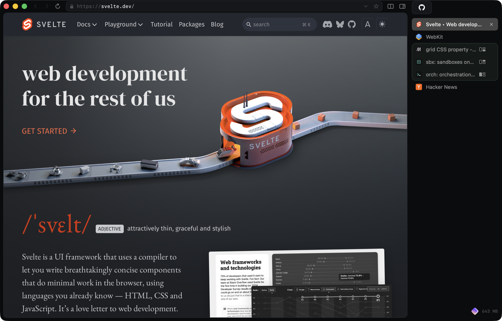

<p align="center"><strong>Tern</strong></p>
<p align="center">A fast, keyboard-first browser for macOS, built on WebKit with Swift and AppKit.</p>
<p align="center">
  <a href="https://tern.torsten.work">Website</a> ·
  <a href="docs/features.md">Features</a> ·
  <a href="docs/keyboard.md">Keyboard</a> ·
  <a href="docs/agent-api.md">Agent API</a> ·
  <a href="docs/development.md">Development</a>
</p>



> **Status:** early and moving fast. Tern works as a daily browser, but there are no prebuilt releases yet. Build it from source, which takes about a minute.

## Get started

You need macOS 15.4 or later, Xcode 16.3 or later, and [XcodeGen](https://github.com/yonaskolb/XcodeGen).

```sh
brew install xcodegen
git clone https://github.com/TorstenDittmann/tern.git
cd tern
make run       # generate the Xcode project, build Debug, launch
make release   # optimized build: build/Build/Products/Release/Tern.app
```

The first launch walks you through the tab list, compact mode, the main shortcuts, extensions and the agent API.

## Why Tern

- **Native and small.** Plain AppKit around `WKWebView`, with no Electron and no bundled Chromium.
- **Made for the keyboard.** Every command has a shortcut you can rebind, and ⌘J clicks any link from the keyboard.
- **Light on memory.** Restored tabs cost almost nothing until you open them, and idle tabs give their memory back.
- **Private by default.** Ads, trackers and tracking parameters are gone before the page loads, with no extension needed.
- **Open to your agents.** A local API, a `tern` CLI and an MCP server let coding agents drive real tabs, and you can see when they do.

## What's inside

### Move around


| | |
|---|---|
| **Command palette** (⌘K) | Fuzzy-search open tabs, history and every command, or type a URL or search. |
| **Tab picker** (⌘P) | Jump between tabs across all windows, most recently used first. |
| **Link hints** (⌘J) | Every link, button and field gets a short letter code. Type it to click. |
| **Link peek** (⌥-click) | Open a link in a floating preview, then keep it as a tab or a split. |
| **!bangs** | `!gh swift-nio` or `!mdn grid` searches that site directly. About 25 are built in, and you can add your own. |

### Arrange your tabs


| | |
|---|---|
| **Vertical tabs** | On the right by default, or on the left. Filter them with ⌘E. |
| **Split view** | Two to four tabs side by side, stacked or in a grid. [How splits work](docs/split-view.md). |
| **Pinned tabs** | Stay at the top and remember their home page. |
| **Compact mode** (⇧⌘L) | On by default: the address bar stays hidden until you point at the top edge or press ⌘L. |
| **Archive and suspend** | Idle tabs give back memory, and you can archive them after a set time. |

### Browse with less in the way

| | |
|---|---|
| **Blocking** | EasyList and EasyPrivacy, compiled to native WebKit content rules. Local dev servers are left alone. |
| **Private windows** (⇧⌘N) | Cookies and site data live in memory and are gone when the window closes. |
| **Reader** (⌥⌘R) | Just the article, in a calm column. |
| **Extensions** | Chrome Web Store, Safari Web Extensions and unpacked ones. [What's supported](docs/extensions.md). |

### Build for the web

| | |
|---|---|
| **Responsive design mode** (⌃⌘R) | Phone, tablet and laptop sizes with the right user agent and pixel density. |
| **Requests** (⌥⌘N) | Every request the page made, filterable, with copy as cURL. |
| **JSON viewer** | JSON responses open as a collapsible tree. |
| **Web Inspector** (⌥⌘I) | Plus console shortcuts and copy as a Markdown link. |

That's the short list. [All features](docs/features.md) has the rest, including history, bookmarks, downloads and PDF export.

## Let your agent drive

Coding agents and scripts can use Tern through a local JSON-RPC API on a Unix socket, with no network port. It's off until you turn it on with **Enable Agent API** in ⌘K. A tab an agent is acting on gets a purple ring and an "Agent is driving" tag.

```sh
claude mcp add tern -- /Applications/Tern.app/Contents/Helpers/tern mcp
```

Or use the CLI that ships inside the app:

```sh
tern tabs open localhost:3000 --wait idle
tern page snapshot                     # the page as an outline with refs
tern page type e3 "ada@example.com" --submit true
tern console read --level error        # what the page logged
```

The [agent API docs](docs/agent-api.md) cover every method, the event stream and how to limit agents to their own tabs.

## Documentation

- [Features](docs/features.md): everything Tern does
- [Keyboard](docs/keyboard.md): every shortcut, and how to rebind them
- [Split view](docs/split-view.md): layouts, dragging and focus
- [Extensions](docs/extensions.md): where they come from and what's supported
- [Agent API](docs/agent-api.md): the socket API, the CLI and MCP
- [Settings](docs/settings.md): the settings window and `defaults` keys
- [Development](docs/development.md): building, project layout, testing, performance and known limitations

## Contributing

Issues and pull requests are welcome. Please run `make smoke` before opening a PR, and extend it when you add behavior it can check.

## License

[MIT](LICENSE) © Torsten Dittmann
